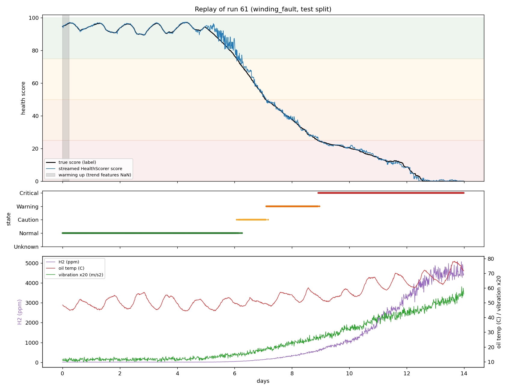

# THMS-ML: transformer health score and state from sensor data

Machine-learning component of a Transformer Health Monitoring System for a
200 kVA, 11 kV / 415 V distribution transformer. From eight live sensor readings it
produces

- a **health score** from 0 to 100 (100 = healthy),
- a **health state**: 0 Normal, 1 Caution, 2 Warning, 3 Critical, and
- the **top reasons** that pulled the score down (SHAP-based, for a dashboard).

The score comes from a LightGBM regressor with monotone constraints (a worse reading
can never raise the score). The state is derived from the score with fixed bands.
A streaming scorer (`HealthScorer`) handles live use: one packet every 15 minutes in,
one result out, with warm-up and missing-sensor handling.



*One dataset run (a winding fault) replayed through `HealthScorer`, one packet at a
time. Black: the label score. Blue: the streamed score. This run belongs to the test
split; the replay is a demonstration and was not used for tuning.*

## Quick start (no dataset needed)

```bash
git clone https://github.com/<your-username>/thms-ml.git
cd thms-ml
python -m venv .venv
source .venv/bin/activate          # Windows PowerShell: .\.venv\Scripts\Activate.ps1
pip install -r requirements.txt
python -m src.infer --csv examples/sample_readings.csv
```

`examples/sample_readings.csv` is a synthetic 48-hour trace (not taken from the
training data) in which a fault develops after 24 hours. The command writes
`examples/sample_readings_scored.csv`. Excerpt:

| row | health_score | state | top reasons (points) |
|----:|-------------:|-------|---|
| 0   | 92.65 | Normal (warming up) | H2 +9.7, Oil temperature -0.6, Vibration +0.6 |
| 95  | 91.46 | Normal  | H2 +7.5, Vibration +0.7, Input/output current mismatch +0.3 |
| 140 | 52.19 | Caution | H2 -25.5, Vibration -7.2, Input/output current mismatch +1.2 |
| 160 | 38.70 | Warning | H2 -34.3, Vibration -9.5, Oil temperature -2.0 |
| 191 | 20.44 | Critical | H2 -45.9, Vibration -11.4, Oil temperature -5.2 |

## Scoring your own readings

**From a CSV**

```bash
python -m src.infer --csv my_readings.csv --out my_scored.csv
```

| Option | Meaning |
|---|---|
| `--map my_col=model_col,...` | rename your columns to the model's sensor names |
| `--timestamp-col NAME` | enables a 15-minute cadence check |
| `--resample-15min` | average faster readings into 15-minute bins (needs `--timestamp-col`) |
| `--no-explain` | skip the top-reasons computation (faster) |
| `--model`, `--meta` | use other model artifacts |

The CSV needs the eight sensor columns `input_current_A`, `output_current_A`,
`output_voltage_V`, `ambient_temp_C`, `humidity_pct`, `vibration_rms_ms2`, `h2_ppm`,
`oil_temp_C` (amps, volts, °C, %, m/s² RMS, ppm, °C), oldest row first, one row every
15 minutes. The H2 rate and oil-temperature slope are computed per sample, so other
spacings mis-scale them; use `--resample-15min` for faster data.

**From Python, one packet at a time (live use)**

```python
from src.infer import HealthScorer

scorer = HealthScorer()              # loads the model and metadata from config paths
packet = {"input_current_A": 3.1, "output_current_A": 82.0, "output_voltage_V": 414.0,
          "ambient_temp_C": 29.5, "humidity_pct": 64.0, "vibration_rms_ms2": 0.62,
          "h2_ppm": 34.0, "oil_temp_C": 52.0}          # one packet every 15 minutes
result = scorer.update(packet)
print(result["health_score"], result["state_name"], result["warming_up"])
```

(`python -m examples.stream_one_packet` runs this snippet with its explanations.)
`update()` always returns the same keys: `health_score`, `health_state`, `state_name`,
`top_reasons`, `warming_up`, `degraded`, `degraded_reasons`, `imputed_sensors`,
`status` (`ok`, `degraded` or `unscorable`), `samples_seen` and `timestamp`.

- **Warm-up.** Trend features need 24 samples (6 h) of history; until then
  `warming_up` is `True` and the score should be treated with more caution.
- **Missing or invalid sensor values** (None, NaN, inf, non-numeric, out of range) are
  replaced by the sensor's last valid value and the result is flagged `degraded`. If a
  sensor has been held for more than 16 samples (4 h), or has never been valid, the
  sample is `unscorable` (score `None`, state `Unknown`) instead of reporting a score
  built on a stale value.
- Because the live scorer calls the same feature function as training on a rolling
  buffer, replaying a run through `update()` reproduces the batch predictions exactly.

## How it works

**Features (22).** The 8 raw sensors plus engineered features, all computed from the
current and past samples only (`src/features.py`):

- load in per-unit (`output_current_A / 278`), oil rise over ambient, and the
  input-vs-expected-input-current residual (expected input =
  `sqrt((I_out / 26.5)^2 + (0.015 * 10.5)^2)`);
- vibration ratio against an expected vibration that depends on voltage and load;
- a normalized distance to the safe limit for H2, oil temperature, load, vibration
  and the absolute current residual: 0 at the Caution threshold, 1 at the Critical
  threshold, capped at 1.5;
- trend features over the trailing 24 samples: H2 rate of rise (ppm/day), oil
  temperature slope (°C/h), vibration rolling mean and H2 rolling max.

**Safe limits.**

| Quantity | Caution | Warning | Critical |
|---|---:|---:|---:|
| H2 (ppm, IEEE C57.104 bands) | 100 | 700 | 1800 |
| Oil temperature (°C) | 80 | 95 | 105 |
| Load (per-unit) | 1.1 | 1.3 | 1.5 |
| Vibration (m/s²) | 2.0 | 3.3 | 5.0 |
| Input-current residual | 5% | 10% | 20% |

**Model.** LightGBM regression on the health score. Eleven features (the distance
features, H2 rate, oil temperature, vibration, rolling vibration, load and the
absolute residual) carry a monotone-decreasing constraint. Hyperparameters were
tuned by random search with run-grouped cross-validation (GroupKFold on `run_id`)
on the train split only; the validation split was used for early stopping and for
choosing among the top three candidates.

**States.** score > 75 Normal; 50 to 75 Caution; 25 to 50 Warning; below 25 Critical.

**Baseline.** A transparent formula with no learning: score = 100 x (1 - severity),
where severity is a piecewise-linear function of the worst normalized distance
(`config.BASELINE_SEVERITY_KNOTS`).

## Results

Validation split (10 runs, 13,440 rows):

| | MAE | RMSE | R² | State accuracy | Macro-F1 |
|---|---:|---:|---:|---:|---:|
| Baseline (formula) | 6.51 | 8.23 | 0.859 | 96.1% | 0.905 |
| LightGBM (monotone) | 0.56 | 1.05 | 0.998 | 99.0% | 0.971 |

Applying the bands to the true validation score reproduces the dataset's state label
99.98% of the time, which is the ceiling for state accuracy.

These are **validation** numbers. The validation split was used for early stopping and
model selection, so they are somewhat optimistic. Results on the held-out test split
come from `src/evaluate.py` (below) and are not part of this README yet.

## Training, evaluation and replay (need the dataset)

The training dataset is **not included** in this repository (see `data/README.md`).
Place it at `data/thms_dataset.csv`, or point `THMS_DATA_PATH` at it.

```bash
python -m src.train                 # about 8 minutes on 2 CPU cores
python -m src.train --n-trials 6    # quicker search
```

Training tunes, fits and saves `models/thms_lgbm.joblib`, `models/thms_model_meta.json`
(feature names, band edges, window, hyperparameters, validation metrics) and
`reports/cv_results.csv`. Splits always come from the dataset's `split` column and are
made by run, never by row.

```bash
python -m src.evaluate --model models/thms_lgbm.joblib --meta models/thms_model_meta.json
```

`src/evaluate.py` is a **one-shot** evaluation on the test split: headline metrics for
the model and the baseline, a breakdown by fault type, detection lead time, robustness
to doubled sensor noise and to a noisy or missing H2 or vibration sensor, and SHAP
plots, all written to `reports/`. It records the model's SHA-256 in
`reports/.test_eval_lock.json` and refuses to evaluate the same model again unless you
pass `--allow-rerun`, so the test set cannot be quietly tuned against.

```bash
python -m src.replay --split val --fault-type thermal_fault   # stream one run, save a plot
```

## Tests

```bash
pytest -q
```

184 tests cover data validation and leakage guards, causality of the features (no
look-ahead), the baseline and bands, training (including a monotonicity sweep), and
the live scorer (streaming equals batch, warm-up, degraded mode, clamping, reasons).
Tests that need the dataset are skipped when it is absent. CI runs the suite on
Python 3.11; the code was also run on Python 3.13.

## Repository layout

```
config.py              column names, thresholds, window, bands, baseline knots, paths, seed
src/data.py            load, validate, leakage guard, run-level splits, class balance
src/features.py        causal feature engineering, feature names, monotone constraints
src/scoring.py         score-to-state bands, baseline formula, metrics
src/train.py           baseline, tuning, model selection, artifacts
src/evaluate.py        one-shot test-split evaluation, robustness, SHAP, top_reasons
src/infer.py           HealthScorer (live, streaming) and the CSV command line
src/replay.py          replay a dataset run through HealthScorer and plot it
tests/                 pytest suite
models/                trained model and its JSON metadata
reports/               cross-validation results (evaluation output goes here too)
examples/              synthetic sample input and a one-packet example script
docs/                  figures
data/                  place the dataset here (not committed)
```

## Limitations

- The model has not been validated on data beyond the supplied dataset. Do not use it
  for safety-critical decisions.
- `models/thms_lgbm.joblib` is a pickle: only load model files you trust.

## License

MIT, see `LICENSE`.
